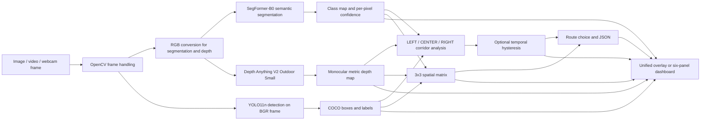

# AllyVision Architecture

## Runtime data flow

## Modules

| Module | Responsibility |
|---|---|
| `allyvision/cli.py` | Parses image/video/camera source and inference/display options; loads models once; handles output, camera lifecycle, JSON, and frame loop. Windows webcam tries DirectShow before Media Foundation. |
| `allyvision/models.py` | Lazy-startup wrapper for pretrained SegFormer-B0 Cityscapes, YOLO11n COCO, and metric depth. Auto-selects CUDA when available, otherwise CPU. |
| `allyvision/depth.py` | Loads local metric Outdoor Small checkpoint or HF fallback; validates metric type and declared range; returns per-pixel depth estimate in meters. |
| `allyvision/pipeline.py` | Runs segment/detect/depth, aligns maps, filters navigation hazard candidates, analyzes sectors, creates payload, and renders visualization. |
| `allyvision/navigation.py` | Corridor geometry, heuristic status thresholds, obstacle overlap/depth checks, route recommendation, and temporal hysteresis. |
| `allyvision/spatial_matrix.py` | Divides the source frame into nine equal cells, intersects every detection box against each cell, derives per-cell semantic coverage/status, and draws the live grid overlay. |
| `allyvision/unified_visualizer.py` | Compact unified image overlay and stable-depth label filtering. |

## Model inputs and outputs

| Model | Input | Output | Runtime use |
|---|---|---|---|
| SegFormer-B0 Cityscapes | RGB image resized via processor (default configured edge 256) | Per-pixel class IDs and max-class confidence | `sidewalk` class can provide positive walkability evidence; `road` is reported separately and alone never makes a route FREE. |
| YOLO11n COCO | BGR frame; default inference size 320 | Boxes, COCO labels, confidence | Reports all detected COCO classes. A specific subset (`NAVIGATION_OBSTACLE_LABELS`) participates in route blocking. |
| Depth Anything V2 Metric Outdoor Small | RGB image, default edge 336 | Per-pixel estimated depth, clamped to checkpoint max 80 m | Samples lower-middle portions of object boxes; median/spread support approximate distance and near-obstacle rules. Video/camera refreshes depth every five frames by default and reuses it in between. |

The label maps in `datasets/config/` are targets for future training, not current runtime model taxonomies. YOLO11n does not recognize arbitrary classes just because the project config lists them. SegFormer produces semantic classes, not per-instance masks.

## Direction analysis

The bottom 48% of aligned class/confidence maps is partitioned into three equal-width regions. The region includes all lower pixels; its bottom band is separately measured. Main conditions implemented in `analyze_directions()`:

1. A qualifying detection intersects a corridor and spatially overlaps enough of it or spans at least 16% of lane width.
2. With depth, an intersecting qualifying object at or within 2 m is `BLOCKED`; if it reaches the near image region but is estimated beyond 2 m, it is `UNCERTAIN`. Without depth, a near-field intersection can be `BLOCKED`.
3. If segmentation confidence is weak (mean <0.48), return `UNCERTAIN`.
4. `FREE` requires walkable fraction ≥0.22, bottom-band fraction ≥0.18, and mean sidewalk confidence ≥0.52.
5. Road-only evidence is `UNCERTAIN`; confident evidence of neither road nor sidewalk can be `BLOCKED`; mixed evidence stays `UNCERTAIN`.

Video/camera smoothing delays FREE until two consecutive positive frames; BLOCKED is immediate. Recommendation prefers a FREE center, otherwise the stronger FREE side. All thresholds and confidence values are heuristics, not calibrated probabilities or safety guarantees.

## Visualization and outputs

- **Six-panel debug:** original frame, segmentation overlay, detection boxes, metric depth, corridor coloring, route decision.
- **Unified:** semantic surface colors, object boxes, corridor statuses, recommendation/message, depth snippets where stable.
- **3×3 spatial localization:** overlaid in source-frame coordinates on the unified view and on the detection panel of the six-panel debug view. JSON returns all nine row-major regions and their per-cell object, semantic, depth, obstacle, and status details.
- JSON contains direction metrics/status/reason, detections, obstacle subset, device, recommendation, route message, and inference time.
- Image output defaults to `outputs/<stem>_unified.jpg`; debug uses `_debug.jpg`. Video can be saved with `--output`.

## Training preparation boundary

The runtime pipeline uses upstream pretrained weights. Preparation scripts define a separate 20-class YOLO detection taxonomy and 18-class SegFormer semantic taxonomy. These are not wired to the existing inference checkpoints. Fine-tuning outputs are intended for `checkpoints/training/`; existing model files are not overwritten. See [TRAINING_GUIDE.md](TRAINING_GUIDE.md).

### Spatial matrix payload

`spatial_matrix` contains exactly nine entries in row-major order: `TOP_LEFT`, `TOP_CENTER`, `TOP_RIGHT`, `MIDDLE_LEFT`, `MIDDLE_CENTER`, `MIDDLE_RIGHT`, `BOTTOM_LEFT`, `BOTTOM_CENTER`, `BOTTOM_RIGHT`. Each entry includes the cell's pixel `bbox_xyxy`, `objects`, `object_count`, mean detection confidence, walkable and road coverage fractions, semantic confidence, obstacle flag, `FREE`/`BLOCKED`/`UNCERTAIN` status, and reason. Each intersecting object's record includes class, detector confidence, full clipped frame box, center coordinates, box/cell intersection and overlap fraction, obstacle designation, and estimated distance when within range and spread thresholds. A box spanning multiple cells is listed in each intersected cell.

Matrix `FREE` uses the existing sidewalk evidence thresholds (walkable coverage ≥22% and mean walkable confidence ≥0.52) and no overlapping navigation obstacle. Road-only is `UNCERTAIN`. Any overlapping navigation obstacle sets the cell to `BLOCKED`; confident segmentation with neither road nor walkable pixels also sets `BLOCKED`. Other cases are `UNCERTAIN`. Cell statuses describe image evidence only and are not equivalent to safe routes. The spatial grid synchronizes to the source frame; no speech or tactile feature is included.
